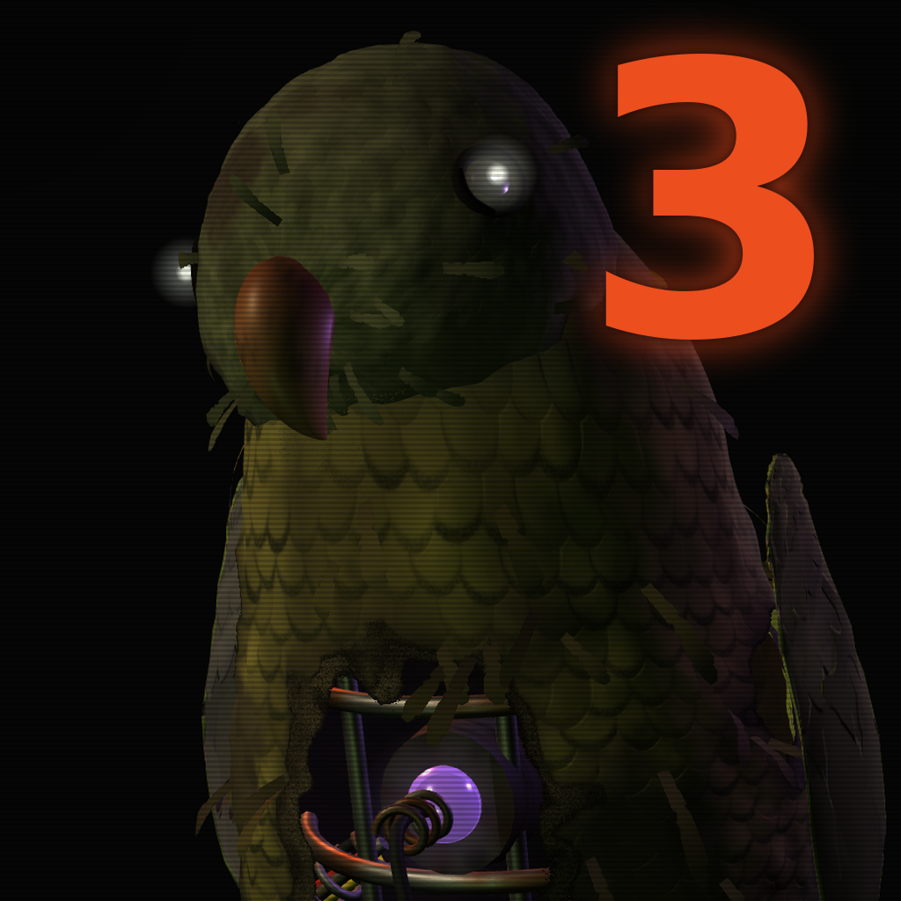

# 5 Nights At Birdies 3

**Play:** https://abbas-is-tuff.github.io/Five-Nights-at-birdies-3/

Thirty years after Birdies closed, its props have been turned into a horror attraction, Birdies' Fright. One real animatronic was found sealed in a back room: **Withered Lemon**. You work the night shift. Survive until 6 AM.

## How to play
- Lemon is the only bird who can kill you. He walks the halls and crawls through the vents toward your office.
- Find him on the cameras, then press **Play Audio** in a room next to his. It plays a tape of Orange singing, and Lemon follows the song.
- On the Vents map, **seal** the vent he's heading for. Seals hold for about 25 seconds.
- If he reaches the doorway (left) or the vent (right), lure him back fast from CAM 01 or CAM 15.
- Audio, cameras and ventilation break down. Reboot them from **Maintenance**.
- With bad ventilation you start seeing phantom birds. Look away from them fast.
- **Orange**, the phone bird, calls at the start of every night with tips.

Keys: Space cameras, M maintenance, A audio, S seal, arrows to look, 1–0 cameras.

## Install on iPad or iPhone
Open the play link in Safari, tap Share, then **Add to Home Screen**. It opens full screen like an app.

## Play offline
Open the game once while online. After that it works with no internet, from Safari or the Home Screen icon. Everything it needs (the 3D engine, fonts and sounds) is in this repo, and `sw.js` saves it on your device.

When you change a game file, bump `VERSION` in `sw.js` (for example `fnab3-v2`) so devices pick up the new version next time they're online.

Nights 1–5, plus Night 6 once you beat Night 5. Progress saves in your browser.
